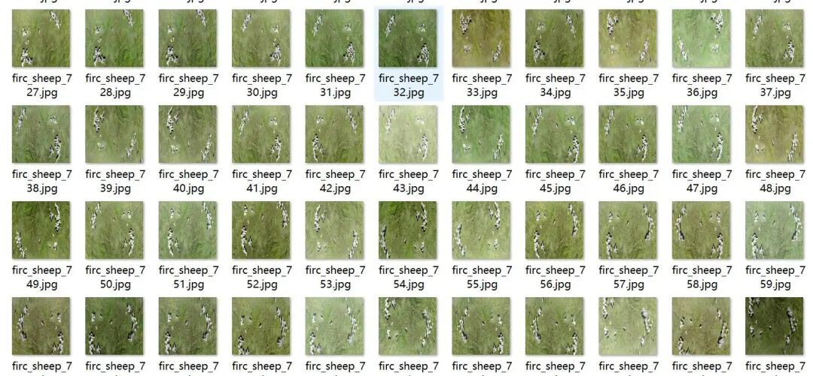
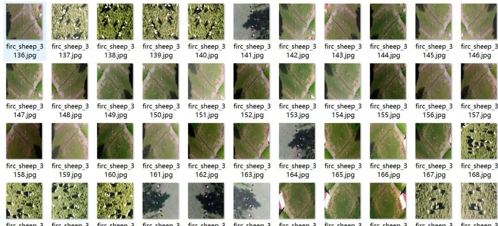
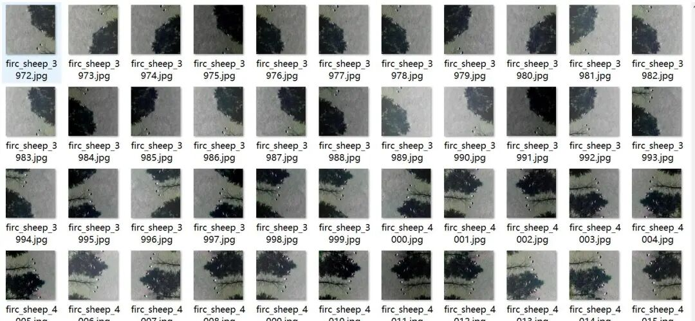
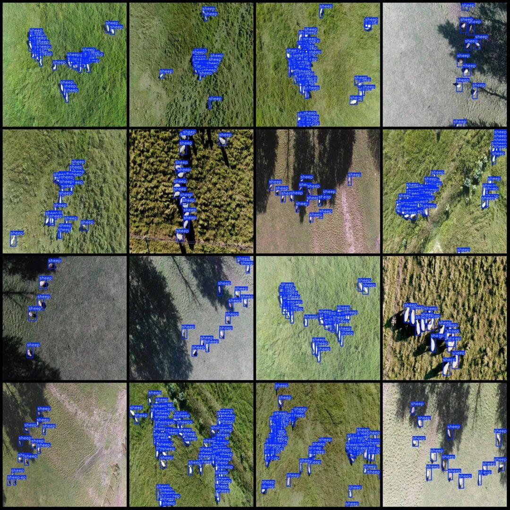

# UAV Sheep Detection Dataset for Mountainous Areas and High Altitudes in VOC+YOLO format with 4046 images in 1 category

Note: The dataset consists of approximately 2500 images, with the remaining being enhanced versions.

Dataset format: Pascal VOC format + YOLO format (txt file without split path, only containing jpg images and corresponding VOC format xml files and yolo format txt files)

Number of images (number of jpg files): 4046

Number of annotations (number of xml files): 4046

Number of annotations (number of txt files): 4046

Label category count: 1

Label category name: ["sheep"]

Number of boxes labeled in each category:

Sheep Frames = 127662

Total frames: 127662

Image resolution: 600x600

Using labelImg:

Annotation rules: Draw a rectangle around the category.

Drone: DJI MAVIC 2

Special : This dataset does not guarantee the accuracy of the trained models or weight files.

Image Preview:

Annotation example:

## Payment

Here is a pay link on Stripe ( https://buy.stripe.com/3cs8yP7sY87d0vu9AB ). Please contact me lonlonago@foxmail.com after funding $89, and I will send you a complete data files , thank you!

